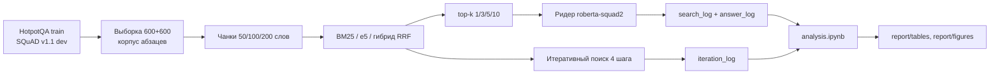

# stat-rag

**Статистический анализ качества RAG: как ретривер, top-k, размер чанка и итеративный поиск влияют на качество поиска и ответа на HotpotQA и SQuAD.**

## Зачем

Учебный проект по курсу статистических методов (тема 18). Система RAG (ретривер + экстрактивный ридер) прогоняется по сетке параметров, каждый прогон пишется в лог поиска и лог ответов, дальше по логам — описательная статистика, проверка гипотез, корреляции, регрессия, классификация правильный/неправильный и динамика по итерациям.

## Стек

```text
Python 3.11, uv
bm25s                       — BM25
sentence-transformers       — intfloat/e5-small-v2 (dense)
transformers + torch (MPS)  — deepset/roberta-base-squad2 (ридер)
pandas, scipy, statsmodels  — статистика
scikit-learn                — классификация
```

## Установка

```bash
uv sync
```

## Быстрый старт

Только анализ по готовым логам (они лежат в `data/logs/`, около 3 МБ) — пара минут:

```bash
uv run python notebooks/build_notebook.py
uv run jupyter nbconvert --to notebook --execute --inplace notebooks/analysis.ipynb
uv run python report/make_tables.py
cd report && xelatex "2026-11-21 Статистический анализ качества RAG.tex"
```

`xelatex` запускать трижды (содержание и ссылки), нужны шрифты PT Serif, PT Sans, PT Mono.

Полный прогон с нуля: скачивание около 350 МБ (HotpotQA train — 326 МБ) и моделей, сетка — 13 минут, итеративный поиск — 3,5 минуты на Apple M4 Pro (MPS). На CPU работает, но медленнее; на MPS/CUDA результаты могут отличаться в последних знаках.

```bash
uv run python scripts/download_data.py
uv run python src/stat_rag/run_grid.py
uv run python src/stat_rag/run_iterative.py
```

Ревизии моделей (`intfloat/e5-small-v2`, `deepset/roberta-base-squad2`) и датасетов Hugging Face закреплены в коде.

## Демонстрация на защите

1. `data/logs/answer_log.parquet` — показать строку лога: конфигурация, найденное, ответ, метрики.
2. `src/stat_rag/run_grid.py` — как устроен прогон (сетка, ридер по top-k).
3. `notebooks/analysis.ipynb` — выполнить разделы 3 и 5 по готовым логам (секунды): гипотезы и регрессия.
4. `uv run pytest tests/ -q` — проверки метрик и разметки релевантности.

## Архитектура



## Тесты

```bash
uv run pytest tests/ -q
```

## Структура проекта

| Модуль | Что делает |
|---|---|
| `src/stat_rag/data.py` | выборка вопросов, корпус, нарезка на чанки, разметка релевантных чанков |
| `src/stat_rag/retrieval.py` | BM25, dense e5, гибрид RRF |
| `src/stat_rag/reader.py` | экстрактивный ридер |
| `src/stat_rag/metrics.py` | EM, F1, наличие ответа в тексте |
| `src/stat_rag/run_grid.py` | прогон по сетке → `search_log`, `answer_log` |
| `src/stat_rag/run_iterative.py` | итеративный поиск → `iteration_log` |
| `notebooks/analysis.ipynb` | весь статистический анализ |

## Структура репозитория

```text
stat-rag/
├── scripts/download_data.py      # скачивание датасетов с Hugging Face
├── src/stat_rag/                 # прогон RAG
├── notebooks/
│   ├── analysis_src.py           # исходник тетрадки
│   ├── build_notebook.py         # сборка .ipynb из исходника
│   └── analysis.ipynb            # анализ
├── report/                       # отчет (LaTeX → PDF), таблицы и рисунки
├── slides/                       # презентация (PDF)
├── tests/                        # тесты метрик и разметки
└── data/                         # raw — сырье (не в git), logs — логи прогона
```
